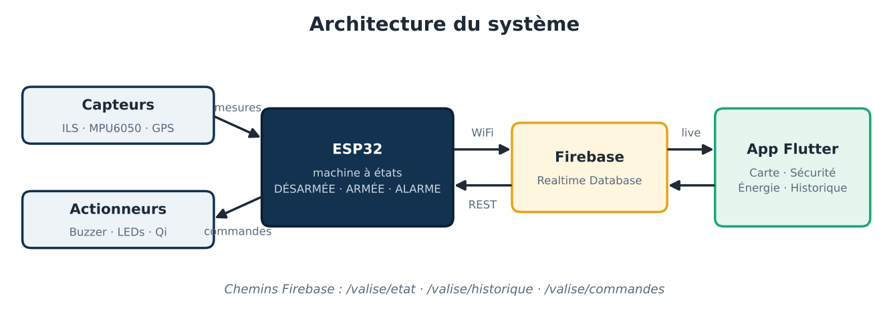
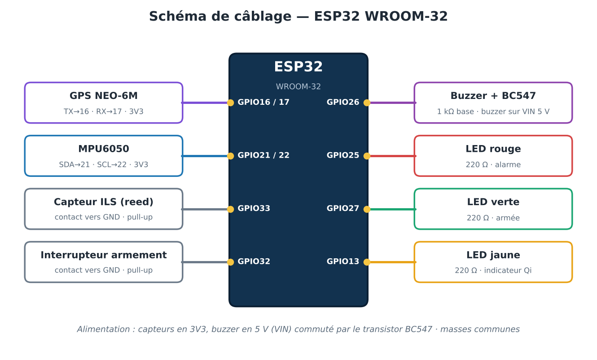
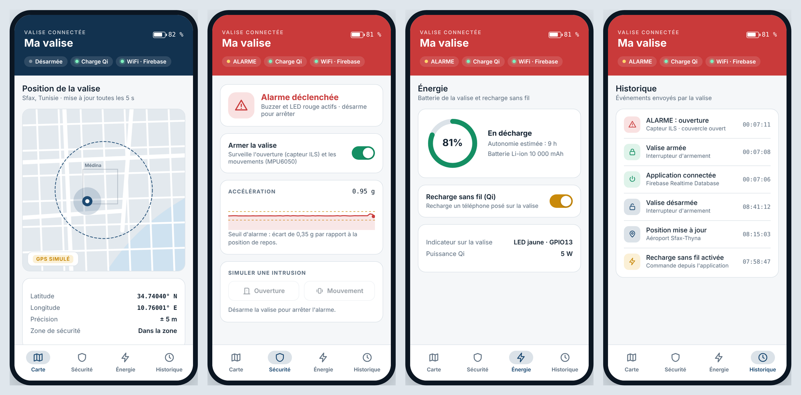

# 🧳 Valise intelligente connectée — ESP32 · Firebase · Flutter

Projet académique de systèmes embarqués : une valise connectée qui **se protège contre l'intrusion**, **se localise** et **communique avec une application mobile**.

> **Statut du projet** : conception, code et simulation réalisés. Les tests sur carte réelle n'ont pas pu être finalisés (voir [Limites et suite du projet](#limites-et-suite-du-projet)).



## Fonctionnalités

| Fonction | Composants | État |
|---|---|---|
| Détection d'ouverture | Capteur ILS (reed switch) + aimant | ✅ Code + simulation |
| Détection de mouvement / vol | Accéléromètre MPU6050 (I2C) | ✅ Code + simulation |
| Alarme sonore et lumineuse | Buzzer via transistor BC547, LED rouge | ✅ Code + simulation |
| Armement / désarmement | Interrupteur + LED verte | ✅ Code + simulation |
| Localisation | GPS NEO-6M (UART) | ⚠️ Position simulée (module non disponible) |
| Recharge sans fil | Module Qi | ⚠️ Remplacé par une LED indicatrice |
| Suivi à distance | Firebase Realtime Database (WiFi, API REST) | ✅ Code |
| Application mobile | Flutter : Carte, Sécurité, Énergie, Historique | ✅ Démo autonome |
| Mode suiveur autonome | — | 💡 Piste d'évolution |

## Fonctionnement

Le programme de l'ESP32 est construit autour d'une **machine à états** :

```
   interrupteur ON              ouverture ou mouvement
DÉSARMÉE ───────────► ARMÉE ─────────────────────────► ALARME
    ▲                   │                                 │
    └───────────────────┴──── interrupteur OFF ◄──────────┘
```

- En **ARMÉE**, la position actuelle de la valise devient la référence. Un écart d'accélération supérieur à 0,35 g, ou l'ouverture du couvercle, déclenche l'alarme.
- En **ALARME**, le buzzer sonne par intermittence et la LED rouge clignote. L'alarme reste active même si le couvercle est refermé : seul le désarmement l'arrête.
- Toutes les 5 secondes, l'état, la position GPS et l'accélération sont envoyés à Firebase. Chaque changement d'état est ajouté à l'historique.

## Câblage



| Composant | Broche ESP32 | Remarque |
|---|---|---|
| GPS NEO-6M | GPIO16 (RX2), GPIO17 (TX2) | Alimentation 3V3 |
| MPU6050 | GPIO21 (SDA), GPIO22 (SCL) | Alimentation 3V3, adresse 0x68 |
| Capteur ILS | GPIO33 | Contact vers GND, pull-up interne |
| Interrupteur d'armement | GPIO32 | Contact vers GND, pull-up interne |
| Buzzer | GPIO26 → 1 kΩ → base BC547 | Buzzer alimenté en 5 V (VIN) |
| LED rouge / verte / jaune | GPIO25 / GPIO27 / GPIO13 | Résistance 220 Ω chacune |

Le buzzer passe par un transistor parce qu'une broche de l'ESP32 ne fournit que 3,3 V et quelques milliampères, ce qui est insuffisant pour un buzzer 5 V.

## Tester en simulation (sans matériel)

Le projet peut tourner gratuitement sur le simulateur en ligne **[Wokwi](https://wokwi.com)** :

1. Sur wokwi.com, crée un nouveau projet **ESP32 (Arduino)**.
2. Remplace le contenu de `diagram.json` par celui de [`simulation/wokwi/diagram.json`](simulation/wokwi/diagram.json).
3. Remplace le contenu de `sketch.ino` par celui de [`simulation/wokwi/sketch.ino`](simulation/wokwi/sketch.ino).
4. Lance la simulation (▶), puis :
   - bascule l'interrupteur **Armement** : la LED verte s'allume ;
   - bascule le **Couvercle** ou clique sur le MPU6050 pour changer l'accélération : l'alarme se déclenche ;
   - suis les messages dans le moniteur série.

## Structure du dépôt

```
valise-intelligente/
├── firmware/valise_esp32/   # programme principal ESP32 (Arduino IDE)
│   ├── valise_esp32.ino
│   ├── config.h             # brochage et options (GPS réel ou simulé, Firebase)
│   └── secrets.example.h    # modèle pour les identifiants WiFi / Firebase
├── tests/                   # 7 programmes pour tester chaque composant séparément
├── simulation/wokwi/        # schéma et programme pour le simulateur Wokwi
├── app/main_demo.dart       # application Flutter (démo autonome)
├── app-web/index.html       # même interface en version web (s'ouvre dans un navigateur)
└── docs/                    # schémas de câblage et d'architecture
```

## Installation sur carte réelle

1. Installer l'**Arduino IDE** et le support des cartes ESP32 (gestionnaire de cartes : « esp32 by Espressif »).
2. Copier `secrets.example.h` en `secrets.h` et renseigner le WiFi et l'URL Firebase.
3. Valider chaque composant **un par un** avec les programmes de `tests/` (dans l'ordre, de `test0` à `test6`).
4. Téléverser `firmware/valise_esp32/valise_esp32.ino`.
5. Pour utiliser le vrai GPS : installer la bibliothèque **TinyGPSPlus** et passer `USE_REAL_GPS` à `1` dans `config.h`.

## Application mobile



L'application a quatre onglets : **Carte** (position GPS et zone de sécurité), **Sécurité** (armement, courbe d'accélération, alarme), **Énergie** (batterie et recharge sans fil) et **Historique** (journal des événements). Les données sont simulées pour pouvoir présenter l'application sans le matériel.

**Démo web** : ouvre [`app-web/index.html`](app-web/index.html) dans un navigateur pour tester l'interface : arme la valise, puis déclenche une intrusion.

**Version Flutter** : `app/main_demo.dart` est la même application en Flutter, en un seul fichier et sans dépendance.

```bash
flutter create valise_app
# remplacer valise_app/lib/main.dart par app/main_demo.dart
cd valise_app && flutter run
```

## Limites et suite du projet

- **Carte ESP32 non détectée par le PC** (aucun port COM dans l'Arduino IDE, malgré l'installation du pilote CP2102 et l'essai de plusieurs câbles et ports USB). La LED d'alimentation s'allume, ce qui oriente vers un câble « charge seule » ou une puce USB défectueuse. Prochaine étape : tester avec un câble de données certifié ou une autre carte.
- **GPS NEO-6M et module Qi indisponibles** : position simulée autour de Sfax et LED à la place du module Qi. Le code du vrai GPS est prêt (`USE_REAL_GPS 1`).
- **Application** : version démo ; la prochaine étape est de la brancher sur Firebase avec le paquet `firebase_database`.
- **Sécurité** : pour un usage réel, il faudrait activer l'authentification Firebase et vérifier le certificat HTTPS (`setInsecure()` est utilisé ici pour simplifier).
- **Mode suiveur** : piste d'évolution (moteurs, capteurs ultrasons, localisation UWB ou Bluetooth).

## Auteur

**Ayoub Drira** — Étudiant en 3e année EEA (Électronique, Énergie électrique, Automatique).
